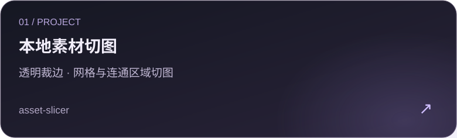
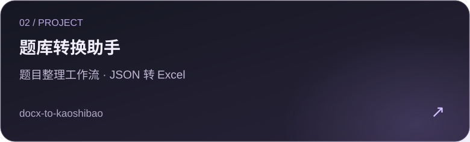
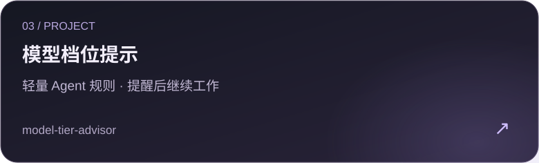
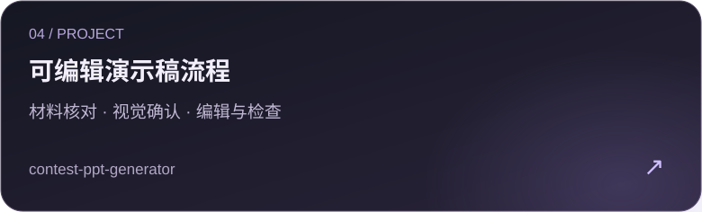

  

我在整理能实际复用的小工具与 Agent 工作流：素材处理、题库转换、模型使用和演示稿制作。

## 精选工具与工作流

- [asset-slicer](https://github.com/libra-sys/asset-slicer)：本地素材处理。
- [docx-to-kaoshibao](https://github.com/libra-sys/docx-to-kaoshibao)：题目整理与 Excel 输出。
- [model-tier-advisor](https://github.com/libra-sys/model-tier-advisor)：模型档位提醒规则。
- [contest-ppt-generator](https://github.com/libra-sys/contest-ppt-generator)：可编辑演示稿制作流程。

> 切图工具按透明区域或已知网格处理素材，不做语义识别；题库脚本接收 JSON，Word/OCR 提取和校对属于前置流程。模型规则只作提醒，演示稿项目提供制作流程。具体依赖、限制与用法请看各仓库说明。

另外可以看看：[截图逆向工程](https://github.com/libra-sys/screenshot-reverse-engineer) · [校园百事通](https://github.com/libra-sys/fjlzy-campus-baishitong)

## 按方向浏览

| 方向 | 入口 |
|---|---|
| 实用工具与制作流程 | [切图、题库、PPT 与更多工具](PROJECTS.md#实用工具与制作流程) |
| 校园与参赛作品 | [校园百事通与创作系列](PROJECTS.md#校园与参赛系列) |
| 行业 Skill | [客服、会议、内容与行业辅助流程](PROJECTS.md#行业-skill-系列) |
| 应用与系统探索 | [智能眼镜、经营分析与研发项目](PROJECTS.md#应用与系统研发) |
| 学习与数据探索 | [网络知识库与电影数据分析](PROJECTS.md#学习与数据探索) |
| Agent 研发与评估 | [工作流编排与评估探索](PROJECTS.md#agent-研发与评估) |

[查看全部 42 个公开仓库分类 →](PROJECTS.md)

这些项目处于不同阶段；目录与精选入口不代表全部功能均已完成或通过完整运行验收。

探索 · 构建 · 迭代

<!-- Visual source and maintenance notes: docs/DESIGN.md -->
